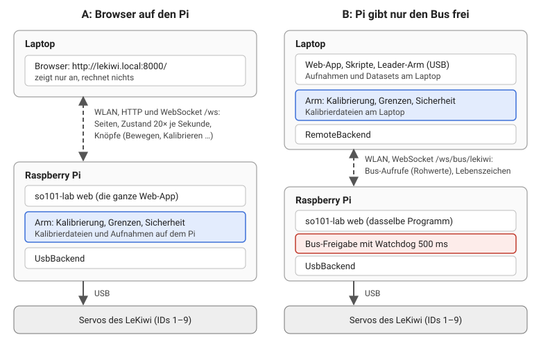
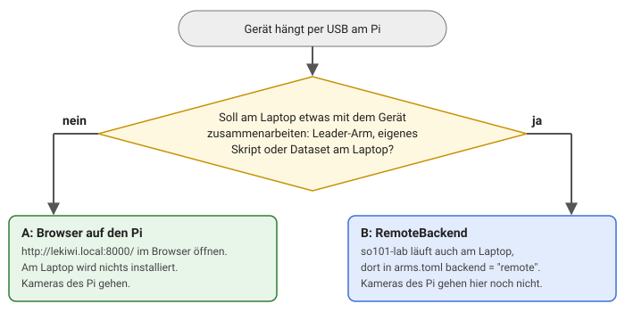
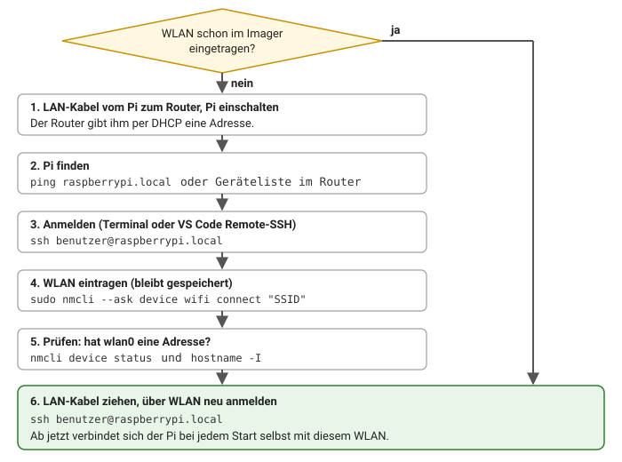

# Netzwerkbetrieb mit Raspberry Pi

Beim LeKiwi sitzt ein Raspberry Pi auf der Fahrbasis, der Servo-Adapter hängt per USB am Pi. Gesteuert
wird vom Laptop über WLAN. Dieses Kapitel folgt dem Aufbau der offiziellen
[LeKiwi-Anleitung von LeRobot](https://huggingface.co/docs/lerobot/lekiwi) (Pi einrichten, SSH, LeRobot
installieren, Host auf dem Pi, Client am Laptop). Statt des LeRobot-Hosts läuft auf dem Pi aber
`so101-lab web`, am Laptop das `RemoteBackend`.

Ein SO-101 ohne LeKiwi funktioniert genauso: Adapter an den Pi, Gerät `so101_follower` eintragen.

!!! note "Kabelgebundene LeKiwi"
    Hängt der Adapter direkt am Laptop, braucht es dieses Kapitel nicht. Dann gelten die Einträge
    `lekiwi`, `lekiwi_arm` und `lekiwi_base` mit `backend = "usb"` aus `config/arms.toml`.

## 1. Wie Laptop und Pi über WLAN zusammenarbeiten

Laptop und Pi sind zwei eigenständige Rechner. Sie finden sich über das gemeinsame Netz: Beide hängen
**im selben WLAN** (am selben Router). Der Router verteilt die Adressen (DHCP). Weil sich eine Adresse
ändern kann, spricht man den Pi über seinen **Namen** an: `<hostname>.local`, also z. B. `lekiwi.local`
oder, ohne eigenen Namen, `raspberrypi.local`. Diese Namensauflösung (mDNS) bringt Raspberry Pi OS mit,
Windows 10/11, macOS und Linux verstehen sie.

Über das Netz laufen nur zwei Verbindungen, beide vom Laptop zum Pi:

| Verbindung | Port | Wozu |
|---|---|---|
| SSH | 22 | Anmelden, Befehle auf dem Pi ausführen, Dateien bearbeiten (Terminal oder VS Code) |
| HTTP und WebSocket | 8000 | `so101-lab web` auf dem Pi: Web-Oberfläche im Browser (Betriebsart A) und Bus-Freigabe für das `RemoteBackend` (Betriebsart B) |

Der Servo-Bus selbst geht nie über das Netz, er hängt immer per USB am Pi. Über das WLAN gehen nur
Befehle und Messwerte. Fällt das WLAN aus, merkt der Pi das selbst und hält die Servos an (Abschnitt
11).

!!! warning "Nicht jedes WLAN geht"
    In Gäste- und Hochschulnetzen (z. B. eduroam) dürfen sich Geräte oft nicht gegenseitig erreichen
    („Client-Isolation“), oder die Anmeldung braucht Benutzername und Zertifikat. Am einfachsten ist ein
    eigener WLAN-Router im Labor, an dem Laptop und Pi hängen.

## 2. Die zwei Betriebsarten

Eine **Betriebsart** legt fest, auf welchem Rechner das eigentliche Programm läuft, also wo gerechnet,
kalibriert und entschieden wird. Die Servos hängen in beiden Fällen am Pi. Auf dem Pi läuft in beiden
Fällen dasselbe Programm, `so101-lab web`. Der Unterschied ist, was der Laptop tut.

**Betriebsart A: Der Pi ist der Laborrechner, der Laptop nur der Bildschirm.** Man öffnet am Laptop im
Browser `http://lekiwi.local:8000/` und sieht dieselbe Web-App wie am eigenen Rechner. Alles, was
Kapitel 02 bis 05 zeigen, läuft auf dem Pi: Kalibrieren, Bewegen, Aufnehmen. Kalibrierdateien und
Aufnahmen landen auf dem Pi. Am Laptop braucht es nur einen Browser. Das ist so, wie man die
Einstellungsseite eines Routers öffnet.

**Betriebsart B: Der Laptop ist der Laborrechner, der Pi ein „verlängertes USB-Kabel“.** Am Laptop läuft
so101-lab (Web-App oder Skripte). In der `arms.toml` des Laptops steht für den LeKiwi
`backend = "remote"`. Jeder Zugriff auf den Bus (Position lesen, Zielwert schreiben …) geht als kleine
Nachricht übers WLAN zum Pi, der Pi führt ihn am USB-Adapter aus und schickt die Antwort zurück.
Gelenknamen, Kalibrierung und Grenzen bleiben am Laptop. So lassen sich Geräte an beiden Rechnern
zusammen benutzen, z. B. der **Leader-Arm per USB am Laptop** steuert den **LeKiwi-Arm am Pi**. Genau so
macht es die LeKiwi-Anleitung von LeRobot (Host auf dem Pi, Client am Laptop).



Blau ist jeweils die Stelle, an der Kalibrierung, Grenzen und Sicherheitsregeln greifen (`Arm`). In B
wacht der Pi zusätzlich selbst über die Verbindung (rot): Kommt 500 ms nichts vom Laptop, hält er die
Servos an.



| | A: Browser auf den Pi | B: RemoteBackend |
|---|---|---|
| Was läuft auf dem Pi | die ganze Web-App | dieselbe Web-App, sie führt nur Bus-Aufrufe aus |
| Was läuft am Laptop | Browser | so101-lab (Web-App, Skripte) |
| Kalibrierdateien, Aufnahmen | auf dem Pi (dort im Repo) | am Laptop |
| Teleoperation mit Leader am Laptop | nein | ja |
| Kameras am Pi | ja | noch nicht (Abschnitt 16) |
| Wann | Vorführung, ein Gerät, Einstieg | Teleoperation, eigene Skripte, Datasets am Laptop |

Umgesetzt ist B im Code so: `backends/remote.py` (Laptop) verpackt jeden Backend-Aufruf als JSON und
schickt ihn über einen WebSocket an `/ws/bus/<gerät>`. Auf dem Pi nimmt `web/bus_server.py` ihn an und
ruft dasselbe `UsbBackend` auf, das auch Betriebsart A benutzt. Die Nachrichten stehen im
[Anhang](anhang.md#bus-freigabe-wsbusname).

A und B lassen sich abwechselnd benutzen, aber nicht gleichzeitig für dasselbe Gerät: Der Port gehört
entweder einer Verbindung im Browser auf dem Pi oder einem Laptop. Die Web-App auf dem Pi zeigt dann
„wird gerade über das Netz benutzt“.

## 3. Pi vorbereiten

Wie in der LeKiwi-Anleitung:

1. Mit dem [Raspberry Pi Imager](https://www.raspberrypi.com/software/) **Raspberry Pi OS (64-bit)** auf
   die Karte schreiben. Die 32-bit-Version geht nicht: torch gibt es dafür nicht.
2. Im Imager unter „Einstellungen bearbeiten“ **Hostname** (z. B. `lekiwi`), **Benutzer und Passwort** und
   **SSH** einstellen. WLAN kann man dort auch gleich eintragen. Fehlt es oder stimmt es nicht, hilft
   Abschnitt 4. Bei SSH **„Passwort zur Authentifizierung verwenden“** wählen. Mit „Nur Public-Key-
   Authentifizierung“ ohne eingetragenen Schlüssel kommt man nicht auf den Pi (Abschnitt 15).
3. Karte einsetzen, Pi einschalten, etwa eine Minute warten.

Ohne eigenen Hostnamen heißt der Pi `raspberrypi`, im Netz also `raspberrypi.local`. In den Beispielen
unten steht `lekiwi.local`: Dort den eigenen Namen einsetzen.

Speicherkarte: mindestens 16 GB, besser 32 GB. Die Umgebung braucht am Laptop 2,1 GB, auf dem Pi
wurde das noch nicht gemessen.

## 4. Pi ins WLAN bringen (über ein LAN-Kabel)

Ist im Imager kein WLAN eingetragen, oder ist es ein anderes WLAN als im Labor, kommt man über ein
LAN-Kabel an den Pi und trägt das WLAN dort ein. Danach kann das Kabel ab.



**1. Kabel anstecken.** LAN-Kabel vom Pi an einen freien LAN-Anschluss des Routers, an dem auch der
Laptop hängt (per WLAN oder Kabel). Pi einschalten. Der Router gibt ihm eine Adresse.

**2. Pi finden.** Am Laptop:

```bash
ping raspberrypi.local        # bzw. ping lekiwi.local, wenn im Imager ein Name gesetzt wurde
```

Antwortet er, steht die Adresse in der Ausgabe. Geht das nicht, in der Web-Oberfläche des Routers
nachsehen. Die Liste heißt je nach Router „Heimnetz → Netzwerk“ (FRITZ!Box, `http://fritz.box`),
„Verbundene Geräte“ oder „DHCP-Clients“. Der Pi erscheint dort mit seinem Hostnamen. Statt des Namens
geht dann überall auch die Adresse, z. B. `ssh benutzer@192.168.178.42`.

**3. Anmelden.** Mit dem Benutzer aus dem Imager:

```bash
ssh benutzer@raspberrypi.local
```

Beim ersten Mal fragt SSH, ob man dem Rechner vertraut: `yes`. Bequemer geht es mit VS Code (Abschnitt 5).

**4. WLAN eintragen.** Raspberry Pi OS verwaltet das Netz mit dem NetworkManager, Befehl `nmcli`:

```bash
sudo nmcli radio wifi on
sudo nmcli device wifi list                         # sichtbare WLANs, eigenes suchen
sudo nmcli --ask device wifi connect "Labor-WLAN"   # fragt nach dem Passwort
```

`--ask` fragt das Passwort ab, statt es in die Befehlszeile zu schreiben (dort stünde es später in der
Befehlshistorie). Das WLAN wird gespeichert und **bei jedem Start automatisch verbunden**. Bei einem
versteckten WLAN `hidden yes` anhängen. Wer lieber ein Menü benutzt: `sudo nmtui` → „Verbindung
aktivieren“, oder `sudo raspi-config` → „System Options“ → „Wireless LAN“.

Meldet `nmcli`, das WLAN sei nicht verfügbar, ist meist noch kein WLAN-Land gesetzt:
`sudo raspi-config` → „Localisation Options“ → „WLAN Country“ → `DE`, danach Schritt 4 wiederholen.

**5. Prüfen.**

```bash
nmcli device status     # wlan0 muss „verbunden“ (connected) zeigen
hostname -I             # jetzt zwei Adressen: eine vom Kabel, eine vom WLAN
```

**6. Kabel ziehen** und neu anmelden: `ssh benutzer@raspberrypi.local`. Der Name zeigt jetzt auf die
WLAN-Adresse. Antwortet er nicht sofort, eine halbe Minute warten (die alte Adresse ist noch gemerkt) oder
die WLAN-Adresse aus Schritt 5 benutzen.

## 5. Bequem arbeiten mit VS Code (Remote-SSH)

Statt im Terminal zu tippen, kann man sich mit VS Code auf den Pi verbinden. Das Fenster sieht aus wie
sonst, aber Dateien, Terminal und Befehle sind **auf dem Pi**. So lässt sich die ganze Einrichtung ab
Abschnitt 6 machen, ohne Bildschirm am Pi.

1. In VS Code die Erweiterung **Remote - SSH** (von Microsoft) installieren.
2. `F1` → „Remote-SSH: Connect to Host…“ → `benutzer@lekiwi.local` eingeben. Plattform „Linux“ wählen,
   Passwort eingeben. Beim ersten Mal installiert VS Code einen kleinen Server auf dem Pi. Dafür braucht
   der Pi Internet, und es dauert etwa eine Minute.
3. Unten links steht jetzt „SSH: lekiwi.local“. **Terminal → Neues Terminal** öffnet eine Shell auf
   dem Pi. Dort laufen alle Befehle aus diesem Kapitel.
4. Nach der Installation (Abschnitt 6) **Datei → Ordner öffnen** → `/home/benutzer/so101_lab`. Dann lässt
   sich z. B. `config/arms.toml` direkt bearbeiten.

Was damit einfacher wird:

- **Dateien hin und her:** Dateien vom eigenen Rechner per Drag & Drop in die Dateiliste von VS Code
  ziehen, sie landen auf dem Pi. Rechtsklick auf eine Datei → „Herunterladen…“ holt sie auf den Laptop.
- **Web-App ohne Token ansehen:** In der Ansicht „Ports“ den Port 8000 weiterleiten. Dann öffnet
  `http://localhost:8000/` am Laptop die Web-App auf dem Pi, verschlüsselt durch die SSH-Verbindung.
  Dafür reicht auf dem Pi `uv run so101-lab web` ohne `--host 0.0.0.0` und ohne Token. Für Betriebsart B
  und den Dienst bleibt es bei `--host 0.0.0.0` mit Token.
- **Ohne Passwort anmelden:** Einmal am Laptop einen Schlüssel erzeugen und auf den Pi kopieren:

  ```bash
  ssh-keygen -t ed25519                       # Enter für alle Fragen
  ssh-copy-id benutzer@lekiwi.local           # Linux und macOS
  ```

  Unter Windows (PowerShell) statt `ssh-copy-id`:

  ```powershell
  type $env:USERPROFILE\.ssh\id_ed25519.pub | ssh benutzer@lekiwi.local "mkdir -p ~/.ssh && cat >> ~/.ssh/authorized_keys"
  ```

Der VS-Code-Server braucht auf dem Pi einige 100 MB Arbeitsspeicher. Auf einem Pi 4 oder 5 ist das kein
Problem, bei 1 GB RAM wird es knapp.

## 6. so101-lab auf dem Pi installieren

Die LeKiwi-Anleitung installiert LeRobot mit conda und `pip install -e ".[lekiwi]"`. Hier kommt dasselbe
LeRobot (0.7.0 mit `feetech`, `lekiwi`, `core-scripts`) über das Lockfile, genau wie am Laptop. torch kommt
als CPU-Version (ohne die mehrere GB großen CUDA-Pakete).

```bash
sudo apt update
sudo apt install -y git build-essential      # build-essential: evdev wird beim Installieren gebaut
curl -LsSf https://astral.sh/uv/install.sh | sh
source ~/.profile                            # uv liegt jetzt in ~/.local/bin
git clone https://github.com/<konto>/so101_lab.git
cd so101_lab
uv sync --no-group dev --no-group docs       # ohne Testwerkzeuge und Doku
uv run so101-lab doctor
```

Für Datasets mit Video auf dem Pi zusätzlich `sudo apt install -y ffmpeg`.

!!! note "Privates Repo klonen"
    Bei einem privaten Repo fragt `git clone` nach Benutzername und Passwort. Als Passwort geht bei GitHub
    nur ein **Token**: GitHub → Settings → Developer settings → Personal access tokens → Fine-grained
    tokens, Zugriff nur auf dieses eine Repo, Recht „Contents: Read-only“. Damit kann der Pi lesen
    (`git clone`, `git pull`), aber nichts ändern. Ein öffentliches Repo braucht das nicht.

## 7. Adapter und Gerät auf dem Pi

Adapter anstecken, Port suchen:

```bash
uv run so101-lab ports
uv run so101-lab scan --port /dev/ttyACM0      # LeKiwi: IDs 1–9
```

Meldet der Port „keine Berechtigung“: Der Benutzer muss in der Gruppe `dialout` sein
(`sudo usermod -aG dialout $USER`, dann neu anmelden). Unter Raspberry Pi OS ist der erste Benutzer
das normalerweise schon.

In `config/arms.toml` **auf dem Pi** den Port fest eintragen. Auf dem Pi gibt es keinen Browser, der
den Port beim Verbinden auswählt:

```toml
[[device]]
name = "lekiwi"
type = "lekiwi"
backend = "usb"
port = "/dev/ttyACM0"
calibration_id = "lekiwi_1"
```

Für `lekiwi_arm` und `lekiwi_base` genauso, jeweils mit demselben Port.

## 8. Token und Start von Hand

Im Netz braucht die Web-App ein Token. Ohne Token startet sie mit `--host 0.0.0.0` gar nicht. Ein
zufälliges Token erzeugen und auf beiden Rechnern verwenden:

```bash
python3 -c "import secrets; print(secrets.token_urlsafe(16))"
```

Auf dem Pi starten:

```bash
SO101_LAB_TOKEN=<token> uv run so101-lab web --host 0.0.0.0 --no-docs
```

Betriebsart A: Am Laptop `http://lekiwi.local:8000/` öffnen und das Token eingeben. Strg+C auf dem Pi
beendet den Server und setzt alle Geräte sicher zurück.

!!! warning "Token ist keine Verschlüsselung"
    Die Verbindung läuft über einfaches HTTP. Das Token schützt vor versehentlichem Zugriff im
    Labornetz, nicht vor Mitlesen. Nur im eigenen WLAN benutzen, nicht ins Internet freigeben.

## 9. Als Dienst beim Einschalten

`so101-lab service` gibt eine fertige systemd-Unit aus, mit dem aktuellen Benutzer, dem Repo-Pfad und
dem Pfad zu `uv`. Erst ansehen, dann installieren:

```bash
uv run so101-lab service
uv run so101-lab service | sudo tee /etc/systemd/system/so101-lab.service
echo "SO101_LAB_TOKEN=<token>" | sudo tee /etc/so101-lab.env
sudo chmod 600 /etc/so101-lab.env            # Token nur für root lesbar
sudo systemctl daemon-reload
sudo systemctl enable --now so101-lab
```

| Befehl | Wirkung |
|---|---|
| `systemctl status so101-lab` | läuft er? letzte Meldungen |
| `journalctl -u so101-lab -f` | Meldungen laufend ansehen (Watchdog, Verbindungen) |
| `sudo systemctl restart so101-lab` | neu starten, z. B. nach Änderung an `arms.toml` |
| `sudo systemctl disable --now so101-lab` | stoppen und nicht mehr beim Einschalten starten |

Beim Stoppen schickt systemd SIGTERM. Der Server setzt dann alle Geräte sicher zurück (Räder stopp,
`safe_state`) und beendet verbundene Laptops.

## 10. Betriebsart B: der Laptop steuert

In `config/arms.toml` **am Laptop** ein Gerät mit `backend = "remote"` eintragen:

```toml
[[device]]
name = "pi_lekiwi"
type = "lekiwi"
backend = "remote"
address = "lekiwi.local:8000"
remote_device = "lekiwi"        # Name in der arms.toml auf dem Pi
calibration_id = "lekiwi_1"
```

`type` muss zum Gerät auf dem Pi passen. Nur ein Teil geht auch: `type = "lekiwi_arm"` gegen
`remote_device = "lekiwi"` benutzt nur die IDs 1–6. Umgekehrt (am Laptop `lekiwi`, auf dem Pi nur ein
Arm) lehnt die Verbindung ab.

Das Token kommt aus der Umgebungsvariable `SO101_REMOTE_TOKEN`. Ein anderer Name lässt sich mit
`token_env` einstellen. `SO101_LAB_TOKEN` ist absichtlich nicht der Standard: Damit würde auch die
Web-App am Laptop ein Token verlangen.

```bash
export SO101_REMOTE_TOKEN=<token>
uv run so101-lab state pi_lekiwi              # nur lesen
uv run scripts/03_move_servo.py --device pi_lekiwi --gelenk arm_gripper
uv run so101-lab web                          # Web-App am Laptop, Gerät pi_lekiwi verbinden
```

Alles aus den Kapiteln 02 bis 05 geht damit auch über das Netz: Kalibrierung, Register, ID-Vergabe,
Aufnahmen, Abspielen. Für die Teleoperation den Leader per USB am Laptop verbinden und `pi_lekiwi`
(oder ein `lekiwi_arm`-Eintrag) als folgendes Gerät wählen. So macht es auch die LeKiwi-Anleitung.

Die Kalibrierdatei liegt in Betriebsart B **am Laptop** (Abschnitt 12). Wird über das Netz kalibriert, landen die
Grenzen im EEPROM der Servos und die Datei am Laptop unter `calibration/robots/lekiwi/`.

### Was über das Netz geht

Über das Netz gehen nur Servo-IDs, Registernamen und Rohwerte. Gelenknamen, Kalibrierung und Grenzen
bleiben am Laptop (`Arm`), genau wie bei einem USB-Gerät. Jede Anfrage bekommt eine Antwort. Es ist
immer nur eine unterwegs.

Folgendes läuft **am Stück auf dem Pi**, nicht in Einzelschritten über das Netz: EEPROM schreiben
(Drehmoment aus, Sperre auf, schreiben, Sperre zu, zurücklesen), ID und Baudrate ändern und den
vollständigen Zustand lesen. Reißt das WLAN mittendrin ab, bleibt also keine EEPROM-Sperre offen. Die
Prüfungen aus Kapitel 03 (EEPROM nur über `write_eeprom`, Wertebereiche, `torque_enable` nur 0/1)
macht der Pi selbst noch einmal.

Gemessen am selben Rechner (Mock, 9 Servos): `read_positions` braucht über das Netz 0,13 ms Median,
`read_state` 0,33 ms. Im WLAN bestimmt die Funkverbindung die Zeit, typisch einige Millisekunden.

## 11. Sicherheit im Netzbetrieb

| Ereignis | Was der Pi tut |
|---|---|
| Laptop beendet ordentlich (Skript-Ende, „Trennen“) | nichts mehr: `open_arm` bzw. die Web-App am Laptop hat schon zurückgesetzt |
| 500 ms kein Lebenszeichen (WLAN weg, Laptop zugeklappt, Absturz) | Räder stopp, dann `safe_state` aus der `arms.toml` **des Pi**, Verbindung beenden |
| Verbindung bricht ab | dasselbe |
| Not-Aus auf dem Pi (Browser auf dem Pi, Esc) | Räder stopp, Drehmoment aus, Laptop wird getrennt und muss neu verbinden |
| Not-Aus am Laptop | geht über das Netz an den Pi (Räder stopp, Drehmoment aus) |
| Dienst wird gestoppt | Räder stopp, `safe_state`, Laptop wird getrennt |

Das `RemoteBackend` schickt alle 100 ms ein Lebenszeichen, auch wenn ein Skript gerade auf eine Eingabe
wartet. Den Watchdog stellt `so101-lab web --bus-watchdog-ms` ein (100 bis 2000, Standard 500 wie beim
LeKiwi-Host von LeRobot). Die Zeit, in der der Pi selbst an einer Anfrage arbeitet (eine Suche über alle
Baudraten dauert etwa 8 s), zählt nicht mit.

!!! danger "Der Watchdog ersetzt keinen Not-Aus-Schalter"
    Hängt der Pi selbst (Stromversorgung, Absturz), stoppt nichts mehr per Software. Bei der Fahrbasis
    muss der Akku- bzw. Netzteilschalter erreichbar sein.

`safe_state = "torque_off"` (Standard) heißt: Der Arm sinkt beim Watchdog unter seinem Gewicht ab. Wer
das bei Funkaussetzern nicht will, stellt in der `arms.toml` auf dem Pi `safe_state = "hold"` ein. Die
Räder halten in beiden Fällen an.

## 12. Kalibrierdateien zwischen Laptop und Pi

Wo die Datei gebraucht wird, hängt von der Betriebsart ab: In **A** liest die Web-App auf dem Pi sie aus
dem Repo auf dem Pi, in **B** liest der Laptop sie aus seinem eigenen Repo. In B muss also nichts
übertragen werden. Für A gibt es drei Wege, in beide Richtungen:

| Weg | So geht es | Prüfung | Gut für |
|---|---|---|---|
| **Web-App** | Am Laptop `so101-lab web`, Reiter **Kalibrierdateien**, in der Zeile der Datei „JSON“ herunterladen. Dann im Browser die Web-App des Pi öffnen (`http://lekiwi.local:8000/`), Reiter **Kalibrierdateien** → **Importieren**: Gerätetyp, Kalibrier-ID, Datei wählen | ja: Gelenke, IDs, Bereiche; vorhandene Datei nur mit Haken ersetzt, alte bleibt als Backup | einzelne Dateien, ohne git und ohne SSH |
| **git** | Am Laptop `git add calibration/… && git commit && git push`, auf dem Pi `git pull` | nein, aber jede Änderung ist nachvollziehbar | dauerhafte Ablage, mehrere Rechner |
| **VS Code** | Mit Remote-SSH verbunden (Abschnitt 5) die Datei per Drag & Drop in `calibration/robots/lekiwi/` (bzw. `so_follower`, `teleoperators/so_leader`) ziehen | nein | schnell zwischendurch |

Die Web-App ist der sicherste Weg, weil sie die Datei vor dem Ablegen prüft und nichts ohne Rückfrage
überschreibt. Nach git oder Drag & Drop in der Web-App des Pi „Liste neu laden“ drücken. Ist das Gerät
schon verbunden, außerdem „Datei neu laden“.

Danach im Reiter **Kalibrierdateien** unter „Abgleich mit den Servos“ **Vergleichen**: Passen Datei und
EEPROM nicht zusammen (die Datei kam von einer anderen Kalibrierung), schreibt **Datei in die Servos
schreiben** die Werte ins EEPROM.

## 13. Ohne Hardware ausprobieren

Zwei Web-Apps auf demselben Rechner, eine spielt den Pi:

```bash
# Terminal 1: „Pi“ auf Port 8001, mit dem Mock-Gerät demo
SO101_LAB_TOKEN=test uv run so101-lab web --port 8001 --no-docs
```

```toml
# config/arms.toml am „Laptop“, zusätzlicher Eintrag
[[device]]
name = "pi_demo"
type = "so101_follower"
backend = "remote"
address = "127.0.0.1:8001"
remote_device = "demo"
```

```bash
# Terminal 2
SO101_REMOTE_TOKEN=test uv run so101-lab state pi_demo
```

## 14. Alternative: der LeKiwi-Host von LeRobot

LeRobot ist auf dem Pi vollständig installiert, der Weg aus der LeKiwi-Anleitung geht also auch:

```bash
uv run python -m lerobot.robots.lekiwi.lekiwi_host \
    --robot.id=lekiwi_1 --robot.port=/dev/ttyACM0 \
    --robot.calibration_dir=calibration/robots/lekiwi \
    --host.connection_time_s=600
```

Am Laptop dann LeRobots Beispiele mit `lekiwi_client` und `remote_ip`. Unterschiede zu so101-lab:
`LeKiwi.connect()` schreibt beim Verbinden Regelparameter ins EEPROM und schaltet das Drehmoment aller
Motoren ein (Kapitel [Servos verstehen](03-servos.md)). Der Host beendet sich nach `connection_time_s` (Standard 30 s), und sein
Watchdog stoppt nur die Räder. Nicht gleichzeitig mit `so101-lab web` am selben Port starten.

## 15. Fehlersuche

| Meldung am Laptop | Ursache und Abhilfe |
|---|---|
| `ssh`: `Permission denied (publickey)`, keine Passwortabfrage | Ping geht und Port 22 ist offen, aber der Pi erlaubt nur Anmeldung mit Schlüssel (Imager: „Nur Public-Key-Authentifizierung“, oder SSH ohne Schlüssel aktiviert). `ssh -v` zeigt `Authentications that can continue: publickey`. Abhilfe siehe unten „SSH ohne Passwort-Anmeldung“ |
| `ping lekiwi.local` findet nichts | Name falsch (ohne eigenen Namen: `raspberrypi.local`), Pi noch nicht hochgefahren, oder anderes Netz. Adresse aus der Geräteliste des Routers nehmen (Abschnitt 4) |
| Pi ist im WLAN, Laptop erreicht ihn trotzdem nicht | Gäste- oder Hochschulnetz mit Client-Isolation (Abschnitt 1). Eigenen Router benutzen |
| `nmcli`: WLAN nicht verfügbar | WLAN-Land fehlt: `sudo raspi-config` → Localisation Options → WLAN Country |
| VS Code hängt bei „Installing VS Code Server“ | der Pi braucht Internet (WLAN oder Kabel am Router) |
| `Keine Verbindung zu ws://…` | Pi aus, anderes Netz, Dienst läuft nicht. Am Laptop `ping lekiwi.local`, auf dem Pi `systemctl status so101-lab` |
| `Pi lehnt ab: Token fehlt oder ist falsch.` | `SO101_REMOTE_TOKEN` am Laptop ≠ `SO101_LAB_TOKEN` auf dem Pi |
| `Pi lehnt ab: Gerät '…' steht nicht in der Konfiguration` | `remote_device` passt nicht zur `arms.toml` auf dem Pi |
| `Pi lehnt ab: Auf dem Pi fehlt für '…' der Port` | auf dem Pi `port = "/dev/ttyACM0"` eintragen (Abschnitt 7) |
| `Pi lehnt ab: … wird schon von … benutzt` | anderer Laptop verbunden oder Gerät im Browser auf dem Pi verbunden: dort trennen |
| `… mit den IDs […], hier werden […] erwartet` | `type` am Laptop passt nicht zum Gerät auf dem Pi |
| `Pi hat die Verbindung beendet: Watchdog …` | WLAN-Aussetzer länger als der Watchdog. Neu verbinden, eventuell `--bus-watchdog-ms` erhöhen |
| `Pi hat die Verbindung beendet: Not-Aus …` | Not-Aus auf dem Pi. Neu verbinden |
| `Pi antwortet nicht auf '…'` | Verbindung hängt. Neu verbinden, `journalctl -u so101-lab` ansehen |

Wie in der LeKiwi-Anleitung: Geht SSH nicht, auf dem Pi `sudo raspi-config` → Interface Options → SSH.

### SSH ohne Passwort-Anmeldung

Antwortet der Pi auf Ping und ist Port 22 offen (`nc -v 192.168.178.85 22` zeigt `SSH-2.0-OpenSSH…`),
kommt aber nur `Permission denied (publickey)`, ist die Passwort-Anmeldung auf dem Pi abgeschaltet.
Der Benutzername ist dann nicht das Problem. Man braucht einen Zugang, der ohne SSH funktioniert:

| Weg | So geht es | Aufwand |
|---|---|---|
| **Bildschirm und Tastatur** | Am Pi lokal anmelden, in `/etc/ssh/sshd_config` und `/etc/ssh/sshd_config.d/*.conf` `PasswordAuthentication yes` setzen, `sudo systemctl restart ssh`. Alternativ den eigenen öffentlichen Schlüssel in `~/.ssh/authorized_keys` eintragen. Je nach Modell hat der Pi Mini-HDMI (Pi Zero) oder Micro-HDMI (Pi 4, Pi 5): Dafür braucht man ein passendes Kabel oder einen Adapter | gering |
| **SD-Karte am Laptop** | Karte in den Kartenleser. Die große Partition (ext4, `rootfs`) einhängen und dort `etc/ssh/sshd_config.d/` eine Datei `50-passwort.conf` mit `PasswordAuthentication yes` anlegen (mit `sudo`). Oder den Schlüssel in `home/<benutzer>/.ssh/authorized_keys` legen (Besitzer und Rechte des Benutzers beachten: Ordner `700`, Datei `600`) | mittel |
| **Neu flashen** | Im Imager bei SSH „Passwort zur Authentifizierung verwenden“ wählen oder den eigenen öffentlichen Schlüssel (`~/.ssh/id_ed25519.pub`) eintragen | einmal alles neu |
| **Anderer Rechner** | Von einem Rechner mit Zugang anmelden und den eigenen Schlüssel eintragen | gering |

Mit Schlüssel statt Passwort: am Laptop `ssh-keygen -t ed25519` (Enter für alle Fragen), den Inhalt von
`~/.ssh/id_ed25519.pub` auf den Pi bringen (Abschnitt 5, `ssh-copy-id` geht nur, solange die
Passwort-Anmeldung noch an ist). VNC oder andere Fernzugänge sind auf einem frisch eingerichteten
Pi nicht aktiv: Außer Port 22 ist dort normalerweise nichts offen.

## 16. Noch offen

- **Kameras am Pi in Betriebsart B:** Bilder gehen noch nicht über das `RemoteBackend`. Für Datasets mit
  den LeKiwi-Kameras (vorne, Handgelenk) entweder Betriebsart A benutzen oder auf Phase 9 warten.
- **Messungen auf einem echten Pi** (Installationsdauer, Platz, RAM, Rate im WLAN) stehen aus.
