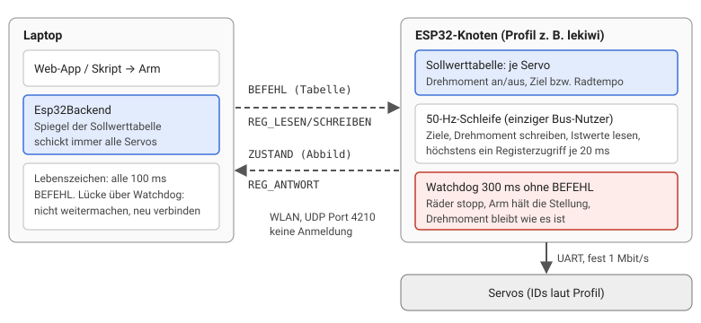

# ESP32-Funkknoten

Statt eines Raspberry Pi kann auch ein **ESP32** am Servo-Bus hängen. Der ESP32 ist ein kleiner
Mikrocontroller mit WLAN. Seine Firmware liegt im Repo unter `firmware/esp32/`. Wie man sie aufspielt
und den Knoten ins WLAN bringt, steht in `firmware/esp32/README.md` (Abschnitt „Einrichtung über die
Webseite“). Dieses Kapitel zeigt, wie so101-lab mit einem fertig eingerichteten
Knoten arbeitet: in `arms.toml` `backend = "esp32"`, alles andere wie gewohnt.

!!! warning "Stand"
    Getestet ist das `Esp32Backend` gegen einen am PC nachgebauten Knoten (Abschnitt 7), der die Regeln der
    Firmware nachbildet. **An einem echten Knoten ist es noch nicht geprüft.** Laut Firmware-README sind dort
    WLAN, Datenübertragung und die Räder des LeKiwi getestet, die Profile `so101` und `so101_leader` noch nicht.

## 1. Was anders ist als beim Pi

Der Pi ist ein vollwertiger Rechner mit USB-Adapter: Über das `RemoteBackend` geht jeder einzelne
Buszugriff durch, so als hinge der Adapter am Laptop. Der ESP32 dagegen hat **seinen eigenen, festen
Ablauf**. Er kennt die Servos seines Profils, hält für jeden eine Zeile in einer **Sollwerttabelle**
(Drehmoment an/aus, Ziel bzw. Radtempo) und bedient den Bus in einer eigenen Schleife mit 50 Hz. Der
Laptop schreibt nur in diese Tabelle und bekommt ein Abbild der gemessenen Werte zurück.



| | Raspberry Pi (Kapitel 06) | ESP32-Knoten |
|---|---|---|
| Programm am Servo-Bus | so101-lab (`UsbBackend`) | Firmware mit 50-Hz-Schleife |
| Was über das WLAN geht | jeder Buszugriff einzeln | Sollwerttabelle (`BEFEHL`), Abbild (`ZUSTAND`), einzelne Register |
| Anmeldung | Token | **keine** |
| Watchdog | Pi: Räder stopp, dann `safe_state` | Knoten: Räder stopp, Arm **hält** (Drehmoment bleibt) |
| Baudrate, ID-Vergabe | ja | nein (Bus fest auf 1 Mbit/s) |
| Kameras | ja (Betriebsart A) | nein |

## 2. Knoten finden und eintragen

Knoten und Laptop müssen im selben WLAN sein (Kapitel 06, Abschnitt 1, gilt genauso). Dann:

```bash
uv run so101-lab esp32 suchen
```

```
lekiwi-3fa2      192.168.0.42    Profil lekiwi        WLAN        Firmware 1  Watchdog 300 ms  RSSI -58 dBm  [192.168.0.42:4210]
  Servos (P Position, T Tempo): 1P, 2P, 3P, 4P, 5P, 6P, 7T, 8T, 9T
```

Die Suche schickt ein `PING` an alle (Broadcast) und hört die Baken ab, die jeder Knoten einmal je
Sekunde sendet. Findet sie nichts, den Knoten gezielt fragen: `--ip lekiwi-3fa2.local` oder `--ip 192.168.0.42`.

Eintrag in `config/arms.toml`:

```toml
[[device]]
name = "esp_kiwi"
type = "lekiwi"              # oder lekiwi_arm / lekiwi_base
backend = "esp32"
address = "lekiwi-3fa2.local" # Name aus der Suche, oder die IP
calibration_id = "lekiwi_1"
```

Das **Profil** des Knotens (auf seiner Webseite eingestellt) muss zum Gerätetyp passen, sonst lehnt das
Verbinden mit einer Erklärung ab:

| Gerätetyp in `arms.toml` | passende Profile |
|---|---|
| `lekiwi`, `lekiwi_arm`, `lekiwi_base` | `lekiwi` |
| `so101_follower` | `so101`, `lekiwi` (nur der Arm) |
| `so101_leader` | `so101_leader`, `so101` |

Danach geht alles wie bei einem USB-Gerät:

```bash
uv run so101-lab state esp_kiwi
uv run scripts/03_move_servo.py --device esp_kiwi --gelenk arm_gripper
uv run so101-lab web          # Gerät esp_kiwi verbinden
```

Die Kalibrierdatei liegt am Laptop, wie beim USB-Gerät. Kalibrieren über den ESP32 geht, die Schritte
dauern aber einige Sekunden, weil jeder EEPROM-Wert mehrere einzelne Registerzugriffe braucht.

## 3. Was über den Knoten geht

| Aufruf (Backend) | über den ESP32 | Bemerkung |
|---|---|---|
| Positionen, Zustand lesen | ja | ein `ZUSTAND` mit allen Servos des Profils, Abbild der 50-Hz-Schleife. **Kein Strom** (`current_ma` fehlt) |
| Ziel, Radtempo, Drehmoment | ja | Sollwerttabelle, nur Servos des Profils |
| Tempo- und Beschleunigungsgrenze | ja | als Register, die Firmware überschreibt sie nicht |
| einzelne Register lesen/schreiben | ja | einer je 20-ms-Zyklus, also etwa 50 je Sekunde |
| EEPROM schreiben (Kalibrierung) | ja | wie beim USB-Adapter mit Sperre und Zurücklesen, über einzelne Registerzugriffe |
| Sync-Read/-Write anderer Register | nachgebildet | als Folge einzelner Zugriffe |
| Bus durchsuchen | ja | nur bei 1 Mbit/s, ein Zugriff je ID: alle 254 IDs 5,4 s an der Simulation (am echten Knoten ungemessen) |
| andere Baudraten, Baudrate ändern | nein | der Bus läuft fest mit 1 Mbit/s |
| ID-Vergabe (Einrichtungsassistent) | nein | braucht alle Baudraten. Servos einzeln am USB-Adapter einrichten (Kapitel 02) |
| Drehmoment für Servos außerhalb des Profils | nur aus | die Firmware steuert sie nicht |

## 4. Sicherheit

Weil der Knoten eine Tabelle hält statt jeden Befehl einzeln auszuführen, achtet das `Esp32Backend` auf
drei Dinge, die bei USB und Pi nicht vorkommen:

1. **Immer die ganze Tabelle schicken.** Übernimmt eine neue Quelle die Steuerung, gilt mit ihrem ersten
   `BEFEHL` die *ganze* Tabelle des Knotens, auch alte Zeilen einer früheren Quelle. Ein vergessenes
   „Drehmoment an, Ziel 100“ würde sonst plötzlich ausgeführt. Darum schickt das Backend jedes Mal alle
   Servos, beginnend mit dem gemessenen Zustand (Drehmoment wie gemeldet, Ziel = Istposition, Rad = 0).
2. **Kein Sprung beim Einschalten.** Wird das Drehmoment eingeschaltet, ohne dass vorher ein Ziel gesetzt
   wurde, nimmt das Backend die gerade gemessene Position als Ziel.
3. **Nach einer Lücke nicht weitermachen.** Das Backend wiederholt den `BEFEHL` alle 100 ms. Kam länger als
   der Watchdog keine Antwort (WLAN weg), ist der Knoten schon im sicheren Zustand. Das Backend schickt
   dann nichts mehr. Die alten Sollwerte würden sonst die Räder wieder anfahren lassen. Es meldet
   „Neu verbinden“.

| Ereignis | Was passiert |
|---|---|
| Skript endet, „Trennen“ in der Web-App | Räder stopp, `safe_state` (Standard: Drehmoment aus), warten bis der Knoten das meldet, dann `STOPP`: Steuerung frei |
| WLAN weg, Laptop aus, Absturz (länger als der Watchdog, Standard 300 ms) | **Knoten:** Räder stopp, Arm **hält** die Stellung, Drehmoment bleibt an. `safe_state` gilt hier nicht |
| Not-Aus am Laptop | Räder 0, dann Drehmoment aus für jeden Servo |
| Ein anderer Laptop steuert schon („belegt“) | Befehle werden abgelehnt. Zum Anhalten schickt das Backend `STOPP` (darf jeder): Räder stehen, Arm hält, **Drehmoment bleibt an** |
| Rad soll aus | erst Tempo 0, zwei Zyklen warten, dann Drehmoment aus. Sonst bliebe das alte Tempo im Servo stehen |

!!! danger "Keine Anmeldung"
    Das Funkprotokoll hat kein Token. Jeder im selben WLAN kann `STOPP` senden, die Steuerung übernehmen,
    sobald sie frei ist, und **Register schreiben, auch im EEPROM**. Knoten nur im eigenen Labornetz
    betreiben. Ein Not-Aus-Schalter an der Versorgung bleibt Pflicht.

Der Watchdog des Knotens lässt sich auf seiner Webseite einstellen (100 bis 2000 ms). Das Backend liest
ihn beim Verbinden und passt sein Lebenszeichen an.

## 5. Mehrere Laptops

Es steuert immer nur einer: der Absender (IP und Port) des letzten angenommenen `BEFEHL`. Andere bekommen
„belegt“, bis der erste länger als der Watchdog schweigt oder `STOPP` sendet. **Lesen dürfen alle**
(`so101-lab state`, Web-App ohne Steuerrecht), lesen übernimmt keine Steuerung.

## 6. Das Protokoll in Kürze

Pakete mit 7 Byte Kopf, Nutzdaten und CRC-16, über UDP an Port 4210 (Firmware: `lib/protokoll/protokoll.h`,
in Python `so101_lab/backends/esp32_protocol.py`). Ungültige Pakete verwirft der Knoten ohne Antwort.

| Typ | vom Laptop | Antwort |
|---|---|---|
| `PING` | „wer bist du?“ | `INFO`: Name, Profil, IP, Firmware, Watchdog, Servos |
| `BEFEHL` | Sollwerte (`id`, Drehmoment, Wert) | `ZUSTAND`, mit `BELEGT`, wenn abgelehnt |
| `ZUSTAND_ANFRAGE` | nur lesen | `ZUSTAND`: je Servo Position, Tempo, Last, Spannung, Temperatur, Status |
| `STOPP` | sicherer Zustand, Steuerung frei | `ZUSTAND` |
| `REG_LESEN`, `REG_SCHREIBEN` | Register (1 bis 32 Byte) | `REG_ANTWORT` |

Ein Test vergleicht die Pakete mit dem Werkzeug der Firmware (`firmware/esp32/werkzeuge/knoten_test.py`).

## 7. Ohne Hardware ausprobieren

`so101-lab esp32 sim` startet einen nachgebauten Knoten am eigenen Rechner. Er bildet die Regeln der
Firmware nach (Sollwerttabelle, Watchdog, Belegt, `STOPP`, ein Registerzugriff je Zyklus), darunter
laufen simulierte Servos.

```bash
# Terminal 1
uv run so101-lab esp32 sim --profil lekiwi
```

```toml
# config/arms.toml
[[device]]
name = "esp_sim"
type = "lekiwi"
backend = "esp32"
address = "127.0.0.1:4210"
```

```bash
# Terminal 2
uv run so101-lab esp32 suchen --ip 127.0.0.1
uv run so101-lab state esp_sim
uv run so101-lab web            # esp_sim verbinden
```

Terminal 1 zeigt, was der Knoten tut („Steuerung jetzt über UDP …“, „Watchdog: Räder stopp, Arm hält“).
Zum Ausprobieren des Watchdogs: in Terminal 2 das Skript mit Strg+Z anhalten.

## 8. Fehlersuche

| Meldung | Ursache und Abhilfe |
|---|---|
| `ESP32 '…' nicht gefunden` | Name nicht auflösbar. IP aus `so101-lab esp32 suchen` eintragen |
| `ESP32 '…' antwortet nicht` | Knoten aus, anderes WLAN, Einrichtungsmodus (LED blinkt schnell). Webseite `http://<name>.local/` ansehen |
| `Knoten '…' läuft mit Profil '…'` | Profil auf der Webseite des Knotens zum Gerätetyp passend einstellen (Abschnitt 2) |
| `… wird gerade von einer anderen Quelle gesteuert` | anderer Laptop oder `knoten_test.py`. Dort beenden, oder warten, bis er länger als der Watchdog schweigt |
| `… länger als … ms keine Antwort … Neu verbinden` | WLAN-Aussetzer. Der Knoten hält, neu verbinden. Häufig: Watchdog auf der Webseite erhöhen |
| `Der ESP32-Bus läuft fest mit 1 Mbit/s` | Suche über Baudraten oder ID-Vergabe: Servo einzeln am USB-Adapter einrichten |
| `Profil '…' ist nur lesen` | Leader-Profil: Drehmoment gibt es dort nie |

## 9. Noch offen

- **Gateway (ESP-NOW über USB):** Die Firmware kann es, so101-lab spricht bisher nur UDP über WLAN.
- **Abnahme an einem echten Knoten:** erst ein einzelner Servo, dann Arm und Räder (siehe `PLAN.md`).
