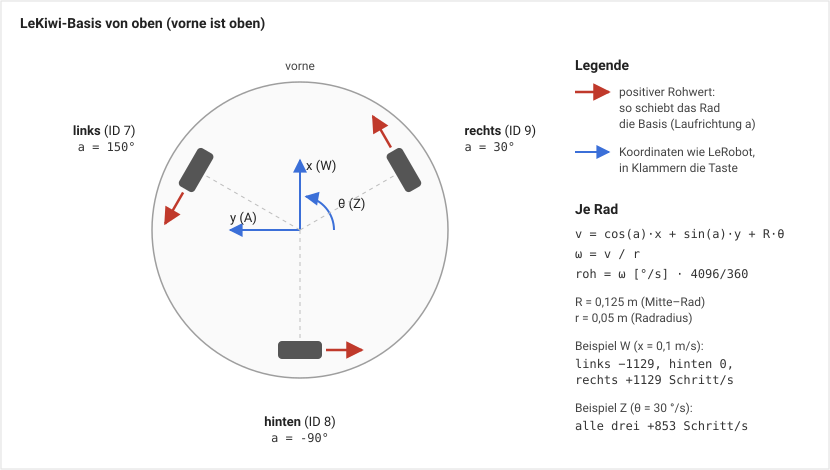

# LeKiwi

Die **LeKiwi** ist eine fahrbare Basis mit drei Allseitenrädern, auf der ein SO-101-Arm sitzt. Alle neun
Servos hängen an **einem** Bus: IDs 1–6 sind der Arm, 7–9 die Räder. Dieses Kapitel erklärt, wie die
Basis fährt: vom Fahrbefehl „vorwärts mit 0,1 m/s“ bis zum Tempo jedes einzelnen Rads.

!!! warning "Stand"
    Das Fahren ist gegen simulierte Servos und den nachgebauten ESP32-Knoten getestet, die Kinematik
    rechnet nachweislich genau wie LeRobot (ein Test vergleicht beide). **An einer echten LeKiwi ist das Fahren
    mit so101-lab noch nicht geprüft.** Deshalb gilt besonders: erst aufgebockt fahren (Abschnitt 4).

## 1. Eine Hardware, drei Gerätetypen

| Typ | IDs | Wofür |
|---|---|---|
| `lekiwi` | 1–9 | Arm und Basis zusammen, wie LeRobots `LeKiwi` |
| `lekiwi_arm` | 1–6 | nur der Arm, die Räder bleiben unberührt |
| `lekiwi_base` | 7–9 | nur die Basis, der Arm bleibt unberührt (**zum Fahren empfohlen**) |

Alle drei teilen sich die Kalibrierdatei `calibration/robots/lekiwi/<id>.json`. Weil sie am selben Bus
hängen, kann immer nur einer verbunden sein. Zum Üben ohne Hardware gibt es das Gerät `demo_kiwi`
(simulierter LeKiwi, Backend `mock`).

Wer mit `lekiwi_base` fährt, hat einen Vorteil: Verliert der Browser das Steuerrecht und gilt
`safe_state = "torque_off"`, geht nur das Drehmoment der Räder aus. Mit `lekiwi` würde auch der Arm
kraftlos und absinken.

## 2. Räder im Geschwindigkeitsmodus

Ein Gelenk des Arms fährt eine **Position** an. Ein Rad soll sich dagegen endlos drehen. Dafür hat der
STS3215 den **Geschwindigkeitsmodus**: Register 33 `operating_mode` = 1. Dann bedeutet `goal_velocity`
(Register 46) nicht mehr „Höchsttempo“, sondern „dreh dich mit diesem Tempo“, in Schritt/s
(4096 Schritt = eine Umdrehung). Das Vorzeichen steht in Bit 15: −1129 heißt 1129 Schritt/s rückwärts.
`present_velocity` (Register 58) meldet das gemessene Tempo.

| | Gelenk (Modus 0) | Rad (Modus 1) |
|---|---|---|
| `goal_position` | Ziel | ohne Bedeutung |
| `goal_velocity` | Höchsttempo auf dem Weg zum Ziel | **Fahrbefehl** |
| `present_position` | Stellung | dreht durch, 0…4095 immer wieder |
| Kalibrierung | Mitte und Bereich | keine nötig |

Ist ein Rad noch im Positionsmodus, lehnen Web-App und Skript 09 das Fahren mit einer Meldung ab. Abhilfe:
im Reiter **Register** das Rad wählen, Expertenmodus einschalten und `operating_mode` = 1 schreiben (EEPROM,
dauerhaft; das Drehmoment des Rads geht dabei aus). LeRobot stellt den Modus bei jedem Verbinden selbst ein
(`LeKiwi.configure()`). so101-lab tut das bewusst nicht von allein (Kapitel 03, EEPROM).

## 3. Kinematik: vom Fahrbefehl zum Radtempo



Der Fahrbefehl hat drei Teile, wie bei LeRobot:

- **x** vorwärts in m/s (Taste W, rückwärts S),
- **y** nach links in m/s (Taste A, nach rechts D),
- **θ** Drehung gegen den Uhrzeigersinn, von oben gesehen, in Grad/s (Taste Z, im Uhrzeigersinn X).

Ein **Allseitenrad** treibt nur in seiner Laufrichtung. Quer dazu rollen die kleinen Rollen an seinem
Umfang frei. Jedes Rad trägt also nur den Teil der Bewegung bei, der in seiner Laufrichtung liegt. Dazu
kommt die Drehung: Dreht sich die Basis, bewegt sich jedes Rad auf einem Kreis mit dem Radius R.

Für ein Rad mit der Laufrichtung a (Winkel zur x-Achse) gilt:

```text
Bahntempo   v = cos(a) · x + sin(a) · y + R · θ        θ in rad/s, R = 0,125 m
Drehtempo   ω = v / r                                  r = 0,05 m (Radradius), ω in rad/s
Rohwert     roh = ω in Grad/s · 4096 / 360             Schritt/s für goal_velocity
```

| Rad | ID | Laufrichtung a |
|---|---|---|
| `base_left_wheel` (links vorne) | 7 | 150° |
| `base_back_wheel` (hinten) | 8 | −90° |
| `base_right_wheel` (rechts vorne) | 9 | 30° |

LeRobot schreibt die Winkel als `[240, 0, 120] − 90`. Das sind dieselben Zahlen.

**Beispiel W** (x = 0,1 m/s): Das hintere Rad hat a = −90°, also cos(a) = 0 und sin(a)·y = 0. Es steht.
Links ist cos(150°) = −0,866, das ergibt v = −0,087 m/s, ω = −1,73 rad/s = −99 °/s = **−1129 Schritt/s**.
Rechts genauso mit +1129. Die beiden vorderen Räder laufen gegeneinander, zusammen schieben sie die
Basis nach vorn.

**Beispiel Z** (θ = 30 °/s): x und y sind 0, es bleibt R · θ = 0,125 m · 0,524 rad/s = 0,065 m/s für
**alle drei** Räder, also je +853 Schritt/s. Die Basis dreht sich auf der Stelle.

Als Matrix geschrieben: `[v_links, v_hinten, v_rechts] = M · [x, y, θ]`, eine Zeile `(cos a, sin a, R)` je
Rad. Rückwärts, aus den gemessenen Radtempi die Bewegung der Basis, geht es mit der inversen Matrix
`M⁻¹`. So entsteht die Anzeige „gemessen“ in der Web-App.

**Begrenzung:** Ist ein Rad schneller als `max_wheel_velocity` aus `arms.toml` (Standard 3000 Schritt/s,
wie LeRobot), werden **alle drei** im gleichen Verhältnis verkleinert. Die Richtung bleibt, die Basis fährt
nur langsamer. Bei x = 0,3 m/s wären links und rechts 3387 Schritt/s nötig, gesendet werden ±3000.

Im Code steht das in `src/so101_lab/kinematics.py` (`body_to_wheels`, `wheels_to_body`).
`Arm.drive(x, y, theta)` rechnet und schreibt, `Arm.read_body_velocity()` liest zurück.

## 4. Fahren in der Web-App

<a class="lab-link" href="../index.html#fahren">In der Web-App ausprobieren</a>

1. **Aufbocken:** Die Basis auf einen Karton o. Ä. stellen, sodass die Räder frei drehen.
2. Gerät `lekiwi_base` (ohne Hardware: `demo_kiwi`) wählen, verbinden, **Steuerung übernehmen**.
3. Reiter **Fahren** öffnen. Taste W kurz drücken: Links und rechts müssen gegenläufig drehen, hinten steht.
   Z: alle drei drehen gleich. Stimmt das, die Basis auf den Boden stellen.
4. Fahren mit den Tasten oder den Schaltflächen (gedrückt halten). Leertaste hält an, Esc ist der Not-Aus.

| Taste | Wirkung |
|---|---|
| W / S | vorwärts / rückwärts |
| A / D | nach links / nach rechts (seitwärts, ohne zu drehen) |
| Z / X | drehen gegen / mit dem Uhrzeigersinn |
| R / F | Tempostufe höher / niedriger |
| Leertaste | anhalten |
| Esc | **Not-Aus** (alle Geräte) |

Tasten lassen sich kombinieren, W und A zusammen fährt schräg nach links vorne. Die Tempostufen
stammen aus LeRobots Tastatur-Client:

| Stufe | x, y | Drehung |
|---|---|---|
| 1 langsam (Start) | 0,1 m/s | 30 °/s |
| 2 mittel | 0,2 m/s | 60 °/s |
| 3 schnell | 0,3 m/s | 90 °/s |

**Was die Web-App absichert:**

- **Totmann:** Gefahren wird nur, solange eine Taste gedrückt ist. Der Browser wiederholt den Befehl alle
  100 ms. Bleibt er länger als **300 ms** aus, hält der Server die Räder an und meldet „Kein Fahrbefehl seit
  … ms“. Das greift auch, wenn das Loslassen der Taste verloren geht.
- Verliert das Fenster den Fokus, wird der Tab gewechselt oder ein anderes Gerät gewählt, hält der Browser
  selbst an. Die Tasten wirken nur im Reiter „Fahren“ und nur, wenn du steuerst.
- **Watchdog** wie immer ([Überblick](index.md#die-web-app)): Bleibt das Lebenszeichen aus, gehen die Räder auf 0 und dann gilt
  `safe_state`.
- Beim ersten Fahrbefehl aus dem Stand prüft der Server die Betriebsart der Räder und schaltet **nur deren**
  Drehmoment ein, mit Tempo 0. Der Arm bleibt, wie er ist.
- „Drehmoment aus“ setzt bei Rädern erst das Tempo auf 0. Sonst bliebe der Fahrbefehl im Register stehen und
  das Rad liefe beim nächsten Einschalten los, auch mit einem anderen Werkzeug.
- Während einer Kalibrierung ist Fahren gesperrt. Abspielen oder Teleoperation des Arms laufen dagegen weiter.

## 5. Skript 09

`scripts/09_drive_base.py` zeigt die Rechnung Schritt für Schritt und fährt auf Wunsch kurz (höchstens 5 s,
höchstens Stufe 3). Standardgerät ist `lekiwi_base`.

```bash
uv run scripts/09_drive_base.py --x 0.1 --rechnen          # nur rechnen, nichts verbinden
uv run scripts/09_drive_base.py --x 0.1 --dauer 1          # 1 s vorwärts
uv run scripts/09_drive_base.py --theta 30 --dauer 2       # 2 s auf der Stelle drehen
uv run scripts/09_drive_base.py --y 0.1 --device demo_kiwi # simuliert
```

Ausgabe von `--x 0.1 --theta 30 --rechnen`:

```text
Fahrbefehl: x = +0.10 m/s, y = +0.00 m/s, Drehung = +30 °/s (+0.524 rad/s)
Radradius r = 0.05 m, Abstand Mitte–Rad R = 0.125 m, 4096 Schritt je Umdrehung

Rad           a   Bahntempo   Drehtempo      roh
links      150°    -0.021 m/s     -24 °/s     -276
hinten     -90°    +0.065 m/s     +75 °/s     +853
rechts      30°    +0.152 m/s    +174 °/s    +1982
```

Beim Fahren gibt das Skript alle 0,25 s das gemessene Tempo aus (aus `present_velocity` zurückgerechnet).
Am Ende hält `open_arm` die Räder an und schaltet je nach `safe_state` das Drehmoment aus.

## 6. Über den Raspberry Pi oder einen ESP32-Knoten

Das Fahren läuft über `Arm`, also mit jedem Backend gleich:

- **Raspberry Pi** (Kapitel 06): In Betriebsart A öffnet man die Web-App des Pi im Browser und fährt dort.
  In Betriebsart B (Gerät mit `backend = "remote"`) fährt man in der Web-App am Laptop. Der Pi stoppt die
  Räder selbst, wenn 500 ms nichts vom Laptop kommt.
- **ESP32-Knoten** (Kapitel 07, Gerät `esp_kiwi`): Die Radtempi gehen in die Sollwerttabelle des Knotens.
  Dessen Firmware stoppt die Räder nach 300 ms ohne Befehl.

## 7. Unterschied zu LeRobot

| | LeRobot (`lekiwi_host`, `lekiwi_client`) | so101-lab |
|---|---|---|
| Rechnung Fahrbefehl → Rad | `_body_to_wheel_raw` | `kinematics.body_to_wheels`, dieselben Zahlen |
| Tasten, Tempostufen | W/A/S/D/Z/X, R/F, 0,1–0,3 m/s | gleich |
| Verbinden | `configure()`: Betriebsarten und Regelwerte ins EEPROM, **Drehmoment an für alle neun** | nichts schreiben, nur die Räder bekommen beim Fahren Drehmoment |
| Wenn die Befehle ausbleiben | Host: Räder stopp nach 500 ms | Web-App: 300 ms Totmann, dazu Watchdog |
| Netz | ZMQ, Ports 5555/5556 | Web-App (HTTP/WebSocket), Port 8000 |

Die Datensätze von LeRobot speichern bei der LeKiwi zusätzlich `x.vel`, `y.vel` und `theta.vel`. Das kommt
in so101-lab im nächsten Schritt (Phase 9b), ebenso Leader-Arm und Fahren gleichzeitig.

## 8. Fehlersuche

| Beobachtung | Ursache und Abhilfe |
|---|---|
| „Räder nicht im Geschwindigkeitsmodus“ | `operating_mode` des genannten Rads auf 1 stellen (Abschnitt 2) |
| „Rad antwortet nicht“ | ID 7, 8 oder 9 fehlt: Kabel der Basis, Netzteil, IDs mit der Suche im Reiter „Einrichtung“ prüfen |
| Bei W dreht sich die Basis, statt geradeaus zu fahren | zwei Räder vertauscht (falsche IDs). Aufgebockt prüfen: Bei W muss **hinten** stehen |
| Bei W fährt die Basis rückwärts oder seitwärts | Einbau weicht von LeRobots Aufbau ab (Räder anders herum montiert oder anders verkabelt). Nicht in der Software umdrehen, sondern den Aufbau mit der Anleitung vergleichen |
| Räder stoppen ruckartig, Meldung „Kein Fahrbefehl seit …“ | Totmann hat gegriffen: Browser-Tab im Hintergrund oder Netz zu langsam. Tab im Vordergrund lassen, beim Pi WLAN prüfen |
| Räder drehen nicht, keine Meldung | Servo-Netzteil aus oder zu schwach: Spannung im Reiter „Status“ ansehen (U/V) |
